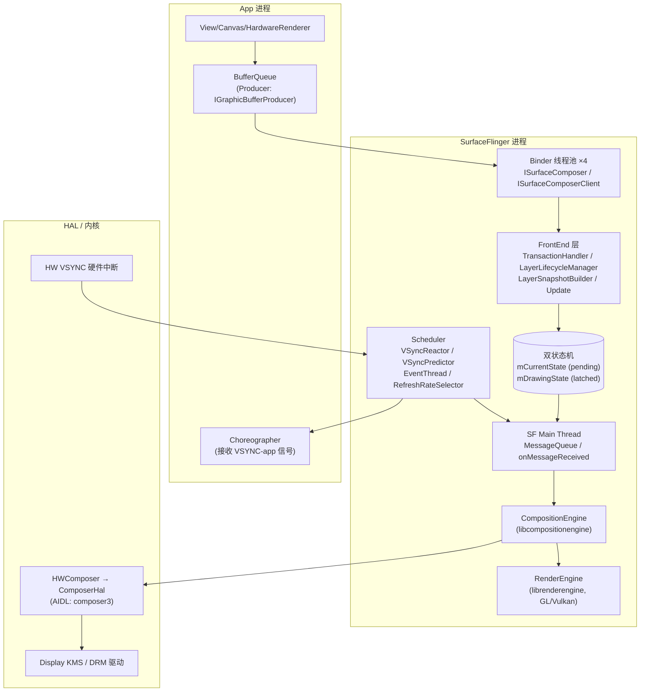
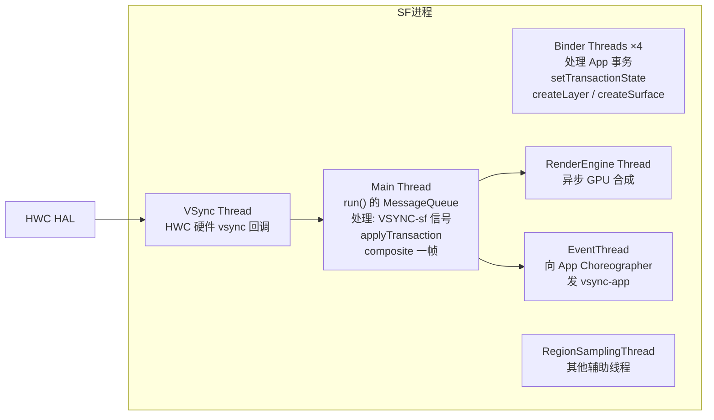
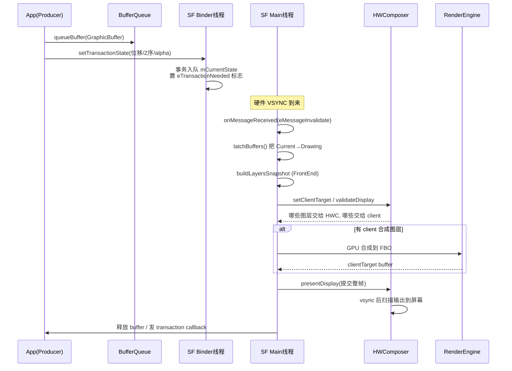

# SurfaceFlinger 架构梳理

> 基于本地 AOSP 源码 `frameworks/native/services/surfaceflinger/` 实际代码梳理，不是教科书摘要。
> 关键结论均标注了对应文件，便于你回跳源码。

---

## 1. 一句话定位

SurfaceFlinger（下文简称 SF）是 Android 系统的**中央合成器（central compositor）**：
它接收所有 App 通过 **BufferQueue** 生产出来的 GraphicBuffer，按窗口层级（Z 序、变换、裁剪、alpha、圆角/阴影/Blur）把它们合成为一张最终图像，再交给 **HWComposer（HWC HAL）** 显示到屏幕上；当 HWC 无法承担全部图层时，由 SF 自己用 **RenderEngine（GPU）** 把多余图层 GPU 合成到 FBO。

它同时是一个 Binder 服务，向 App/SystemServer 暴露两个接口：
- `gui::ISurfaceComposer`（旧 Binder，`BnSurfaceComposer`）
- `gui::ISurfaceComposerClient`（每个 App 一个连接，对应 `Client` 类）
- `SurfaceFlingerAIDL`（新 AIDL 接口，`main_surfaceflinger.cpp:156` 注册）

---

## 2. 进程与启动

文件：`main_surfaceflinger.cpp`

```
main()
 ├── signal(SIGPIPE, SIG_IGN)
 ├── startGraphicsAllocatorService()          // 注册 IAllocator HAL
 ├── ProcessState::setThreadPoolMaxThreadCount(4)   // SF 自己只有 4 个 binder 线程
 ├── sched_setscheduler(SCHED_FIFO, priority=1)    // binder 线程池以 RT 优先级启动
 ├── ps->startThreadPool()
 ├── flinger = surfaceflinger::createSurfaceFlinger()   // 经 Factory 创建
 ├── flinger->init()                          // 必须先 init，再对外提供服务
 ├── sm->addService("SurfaceFlinger", flinger)            // 旧 Binder 接口
 ├── sm->addService("SurfaceFlingerAIDL", composerAIDL)  // 新 AIDL 接口
 ├── startDisplayService()
 └── flinger->run()                           // 当前线程进入 SF 主消息循环
```

几个关键事实：
1. **SF 是独立进程**，由 init 进程通过 `surfaceflinger.rc` 拉起，不是在 SystemServer 里。
2. **binder 线程池被刻意限制为 4**——SF 不希望被 App 的事务请求挤占主线程优先级。
3. **主消息循环跑在 main 线程**（`flinger->run()`），这就是后文的 "SF main thread"。
4. 启动期把线程切成 `SCHED_FIFO` 最低 RT 优先级，并用 `uclamp.min` 兜底——这是为了保证 VSYNC 响应不被 CFS 调度延迟。

---

## 3. 分层架构总览



---

## 4. 核心聚合关系（来自 `SurfaceFlinger.h` 成员）

`SurfaceFlinger` 类本身是一个**门面（Facade）**，真正干活的是它聚合的一堆子系统。下面这些成员直接来自 `SurfaceFlinger.h:1174-1430`：

| 成员 | 类型 | 职责 |
|---|---|---|
| `mFactory` | `surfaceflinger::Factory&` | 工厂抽象，测试时可替换所有子对象（`SurfaceFlingerFactory`） |
| `mStateLock` | `Mutex` | 全局状态锁；**main 线程写、其他线程读**（注释见 :1182） |
| `mCurrentState` | `State` | 客户端刚提交、尚未 latch 的 pending 状态 |
| `mDrawingState` | `State` | 上一帧已经 latch、正在用于合成的状态 |
| `mTransactionFlags` | `atomic<int32_t>` | `eTransactionNeeded` / `eTraversalNeeded` / `eDisplayTransactionNeeded` 等位图 |
| `mDisplays` | `DisplayMap<wp<IBinder>, sp<DisplayDevice>>` | 所有显示设备（物理+虚拟） |
| `mPhysicalDisplays` | `display::PhysicalDisplays` | 物理显示器（折叠屏内/外屏） |
| `mDisplayModeController` | `DisplayModeController` | 刷新率/显示模式切换 |
| `mRenderEngine` | `unique_ptr<renderengine::RenderEngine>` | GPU 合成引擎（独立库 `librenderengine`） |
| `mCompositionEngine` | `unique_ptr<compositionengine::CompositionEngine>` | 合成流程抽象（独立库 `libcompositionengine`） |
| `mScheduler` | `unique_ptr<scheduler::Scheduler>` | VSYNC 调度、帧率选择、App/ SF 双 VSYNC 相位 |
| `mPowerAdvisor` | `unique_ptr<Hwc2::PowerAdvisor>` | 向 HWC 反馈功耗/亮度建议 |
| `mLayerLifecycleManager` | `frontend::LayerLifecycleManager` | **新版前端**：Layer 的创建/销毁/事务合并 |
| `mLayerHierarchyBuilder` | `frontend::LayerHierarchyBuilder` | 构建层级树 |
| `mLayerSnapshotBuilder` | `frontend::LayerSnapshotBuilder` | 把 Layer 状态拍扁成合成用的 Snapshot |
| `mTimeStats` | `shared_ptr<TimeStats>` | 每帧耗时统计 |
| `mFrameTracer` | `unique_ptr<FrameTracer>` | 系统级帧轨迹（system_server 可查询） |
| `mFrameTimeline` | `unique_ptr<frametimeline::FrameTimeline>` | FrameTimeline Jank 分析 |
| `mLayerTracing` / `mTransactionTracing` | - | Perfetto trace 数据源 |
| `mDaltonizer` | `Daltonizer` | 色弱矫正等全局颜色效果 |
| `mRegionSamplingThread` | `sp<RegionSamplingThread>` | 屏幕区域亮度采样（影响自适应亮度） |
| `mWindowInfosListenerInvoker` | `sp<WindowInfosListenerInvoker>` | 向系统侧回推窗口信息 |

### 4.1 Layer 与 LayerFE：合成视角的两面

- `Layer`（`Layer.h`）：**客户端视角**，持有 BufferQueue、Z 序、变换矩阵、alpha、裁剪、CornerRadius、BackgroundBlur 等。
- `LayerFE`（`LayerFE.h`）：**合成视角**（Front End），只暴露合成需要的只读接口（`createCompositionState`、`getLayerSettings`）。
- 设计意图：合成流程（CompositionEngine）不应反向依赖 Layer 的客户端可变状态，所以拆出一个 FE 接口隔离。

---

## 5. 目录结构与子模块职责

```
services/surfaceflinger/
├── main_surfaceflinger.cpp        # 入口
├── SurfaceFlinger.{h,cpp}         # 门面类（核心）
├── Client.{h,cpp}                 # 每个 App 连接对应一个 Client，管理该 App 的 Layer
├── Layer.{h,cpp}                 # 一个窗口/ Surface 对应一个 Layer
├── LayerFE.{h,cpp}                # Layer 的合成侧只读接口
├── DisplayDevice.{h,cpp}          # 一个输出显示器（屏幕/虚拟屏）
│
├── DisplayHardware/              # ← 与 HWC HAL 的桥
│   ├── HWComposer.{h,cpp}        # SF 侧 HWC 客户端
│   ├── ComposerHal.h              # HAL 抽象接口
│   ├── AidlComposerHal.{h,cpp}   # AIDL composer3 实现
│   ├── HidlComposerHal.{h,cpp}   # HIDL composer2.x 兼容实现
│   ├── PowerAdvisor.{h,cpp}       # 功耗/亮度建议
│   ├── FramebufferSurface.{h,cpp}# 屏幕 FB 消费端（GPU 合成结果落地）
│   └── VirtualDisplaySurface.{h,cpp}
│
├── Scheduler/                     # ← VSYNC 与帧率调度
│   ├── Scheduler.{h,cpp}          # 总调度器
│   ├── VSyncReactor.{h,cpp}       # 对 App 响应 VSYNC 事件
│   ├── VSyncPredictor.{h,cpp}     # 预测下一次 VSYNC 时间
│   ├── VSyncTracker.h
│   ├── VsyncSchedule.{h,cpp}      # App/SF 两套 VSYNC 相位
│   ├── MessageQueue.{h,cpp}       # SF 主线程的 Handler
│   ├── EventThread.{h,cpp}        # 向 Choreographer 发 vsync
│   ├── RefreshRateSelector.{h,cpp}# 根据 Layer 历史选帧率
│   └── LayerHistory.{h,cpp}
│
├── FrontEnd/                     # ← 新版事务前端（Android 12+ 重构）
│   ├── TransactionHandler.{h,cpp} # 事务入队与合并
│   ├── LayerLifecycleManager.{h,cpp}
│   ├── LayerSnapshot.{h,cpp}       # 拍扁后的不可变快照
│   ├── LayerSnapshotBuilder.{h,cpp}
│   ├── LayerHierarchy.{h,cpp}
│   ├── Update.{h,cpp}             # 一帧内需要更新的集合
│   └── RequestedLayerState.h
│
├── Display/
│   ├── PhysicalDisplay.{h,cpp}
│   ├── DisplayModeController.{h,cpp}
│   └── DisplaySnapshot.{h,cpp}
│
├── Effects/
│   └── Daltonizer.{h,cpp}         # 色盲矫正、全局饱和度
│
├── FrameTimeline/                 # Jank 分析
├── FrameTracer/                   # 帧轨迹
├── TimeStats/                     # 每帧耗时统计
├── Jank/                          # JankTracker
├── Tracing/                       # Perfetto 数据源
├── EventLog/
└── Utils/
```

### 外部独立库（不在本目录，但 SF 强依赖）

| 库 | 路径 | 作用 |
|---|---|---|
| `libgui` | `frameworks/native/libs/gui/` | BufferQueue、Surface、IConsumerListener、BLASTBufferQueue |
| `libcompositionengine` | `frameworks/native/services/surfaceflinger/CompositionEngine/` | 合成流程抽象（Output/Layer/Composition） |
| `librenderengine` | `frameworks/native/libs/renderengine/` | GL/Vulkan 后端，真正画 GPU 图层 |
| `composer HAL` | `hardware/interfaces/graphics/composer/` | HWC 硬件合成指令 |

---

## 6. 线程模型



**关键锁约定**（`SurfaceFlinger.h:1182-1190` 注释原文）：
- `mStateLock` 保护的状态：
  - **main 线程**可读（用 `FTL_FAKE_GUARD` 标注）、可写（必须真加锁）
  - **其他线程**只读、且必须真加锁
  - 其他线程**不允许写**——写操作全部通过 `mScheduler->schedule(...)` 派发到 main 线程执行

这就是为什么 `mainThreadDumper` 要把 dump 请求 `.get()` 阻塞在 main 线程上跑——因为状态只能在 main 线程写。

---

## 7. 双缓冲状态机：Current vs Drawing

这是 SF 最经典的设计，务必吃透：

```
App 事务 ──> mCurrentState (pending)
                │
                │  main 线程在 VSYNC-sf 时刻 latch
                ▼
          mDrawingState (上一帧合成用的不可变快照)
                │
                │  合成完一帧后 swap
                ▼
          下一帧的 mCurrentState
```

- `mCurrentState`：binder 线程不断往里塞事务（`setTransactionState`），main 线程在下一个 VSYNC 节点把它"提升"为 Drawing。
- `mDrawingState`：main 线程合成期间读它，**其他线程不会改它**，所以合成阶段可以不加锁遍历 Layer 树。
- 这种"生产者-消费者 + 双缓冲"把 binder 线程的锁竞争降到最低：binder 只碰 Current，main 合成时只读 Drawing。

`LayerVector::StateSet` 枚举（`Layer.h`）区分这两种状态集，每个 Layer 内部也维护 `current` 和 `drawing` 两份 `LayerState`。

---

## 8. 一帧的完整生命周期



关键阶段（对应 `SurfaceFlinger.cpp` 函数名）：
1. **`setTransactionState`**：binder 线程把事务塞进队列，置 `mTransactionFlags`。
2. **`onMessageReceived` / `onVSyncEvent`**：main 线程被 MessageQueue 唤醒。
3. **`commitTransaction` / `commitFrameState`**：把 pending 事务应用到 Layer，latch buffer。
4. **`rebuildLayerStacks` / `computeLayerVisibilities`**：计算可见区域。
5. **`CompositionEngine::present`**：
   - 调 HWC `validateDisplay` 询问分区策略
   - 不能走 HWC 的图层交给 RenderEngine GPU 合成
   - `presentDisplay` 提交
6. **`postComposition`**：释放旧 buffer、回调 `ITransactionCompletedListener`、更新统计。

---

## 9. 与 HWC 的分工：HWC 合成 vs GPU 合成

这是理解 SF "为什么存在"的核心：

| 路径 | 谁画 | 优点 | 代价 |
|---|---|---|---|
| **Overlay / HWC 合成** | 显示控制器（DPU/DSI 硬件） | 零 GPU 功耗、零带宽回读、直接从 buffer 扫描输出 | HWC 图层数有限（一般 4~16）、对缩放/旋转/混合格式支持有限 |
| **Client / GPU 合成** | SF 的 RenderEngine (GL/Vulkan) | 任意图层数、任意特效（Blur、Shader、ColorTransform） | 占 GPU、占内存带宽、费电 |

`HWComposer::validateDisplay()` 会让 HAL 告诉你："这些层我硬件能吃，剩下的你自己合成"。SF 把剩下的图层 GPU 合成成一张 `clientTarget` buffer，再交给 HWC 作为一个合成层叠上去。这就是为什么 dumpsys surfaceflinger 里能看到 "Client" 这个特殊 Layer。

---

## 10. 观测与调试入口

学习 SF 时这些工具比读代码还好用：

```bash
adb shell dumpsys SurfaceFlinger           # 全量 dump
adb shell dumpsys SurfaceFlinger --latency <layer-name>
adb shell dumpsys SurfaceFlinger --display-id
adb shell service list | grep SurfaceFlinger
adb shell setprop debug.sf.disable_hwc 1   # 强制全 GPU 合成（debug 后门）
adb shell setprop debug.sf.show_fps 1      # 显示 FPS 浮窗
# Perfetto: 选 "SurfaceFlinger" / "Layers" / "Transactions" 数据源
```

代码里对应的 dump 函数集中在 `SurfaceFlinger.h:1096-1143`（`dumpAll` / `dumpHwc` / `dumpScheduler` / `dumpVsync` / `dumpFrontEnd`）。

---

## 11. 推荐的源码阅读顺序

按这个顺序读，比从头翻 `SurfaceFlinger.cpp`（上万行）高效得多：

1. **`main_surfaceflinger.cpp`** —— 知道 SF 怎么起来。
2. **`SurfaceFlinger.h` 的成员变量区（:1174-1430）** —— 知道 SF 手里有哪些子系统。
3. **`Scheduler/VSyncPredictor.{h,cpp}` + `Scheduler/MessageQueue.{h,cpp}`** —— 理解一帧怎么被 VSYNC 驱动起来。
4. **`Layer.h` + `Layer.cpp::setState` + `Layer::latchBuffer`** —— 一个 Layer 长什么样、buffer 怎么被消费。
5. **`DisplayHardware/HWComposer.cpp::validateDisplay` / `presentDisplay`** —— 理解 HWC 与 SF 的握手。
6. **`FrontEnd/TransactionHandler.cpp` + `LayerSnapshotBuilder.cpp`** —— 新前端事务合并逻辑。
7. **`SurfaceFlinger.cpp::onMessageReceived` → `composite` → `postComposition`** —— 串起一帧的主流程。
8. **`CompositionEngine/`** —— 最后看合成抽象，看 SF 怎么把合成流程拆成可测试的小步骤。

---

## 12. 几个容易踩的认知坑

- **SF 不是"画 UI 的地方"**：App 的 UI 是 App 自己的 HWUI（Canvas/RenderThread）画的，SF 只是把画好的 buffer 拼起来。
- **BufferQueue 在 App 和 SF 之间**：App 是 producer，SF（更准确地说是 `Layer` 内部的 `Surface`）是 consumer。SF 不替 App 画一像素。
- **Choreographer 的 VSYNC 不是 SF 直接发的**：是 HWC 硬件 vsync → SF 的 `VSyncReactor` 打相位 → `EventThread` → App 的 `DisplayEventReceiver`。
- **SF 也吃 VSYNC**：有两条相位，`VSYNC-app` 和 `VSYNC-sf`，错开一个偏移以保证 App 提交完 SF 才 latch。
- **`SurfaceFlingerAIDL` 是新接口**：旧 `ISurfaceComposer` 是 Binder（`.cpp` 后端），新代码在往 AIDL 迁移，读代码时两个入口都要看。

---

*本文档基于本地 `frameworks/native/services/surfaceflinger/` 代码梳理，所有行号引用对应当前 checkout。*